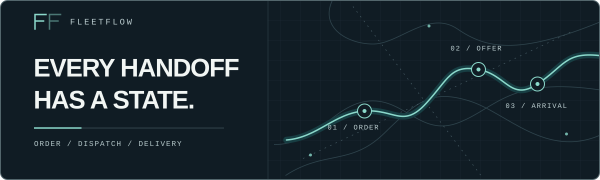
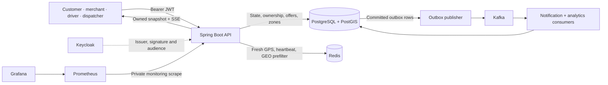

# FleetFlow

**A Java/Spring Boot delivery orchestration learning backend that makes the path from order to delivery explicit, guarded, and observable.** It models customer and merchant workflows, ranks eligible drivers, creates exclusive offers, and follows delivery through completion or recovery.

`Java 21` · `Spring Boot 4.1.1` · `PostgreSQL / PostGIS` · `Redis` · `Kafka` · `Keycloak / OIDC` · `Docker Compose` · `Prometheus / Grafana`

## The project

FleetFlow is a portfolio system for practicing backend engineering at the points where delivery software gets difficult: state transitions, competing dispatchers, changing driver location, geographic serviceability, asynchronous events, and authorization across customer, merchant, driver, and dispatcher roles. Its durable business decisions live in PostgreSQL; Redis supplies short-lived location and proximity data, while Kafka carries committed events from a transactional outbox.

The repository contains a backend and a loopback local demonstration stack. It has no customer-facing frontend or public order intake. The [execution roadmap](docs/ROADMAP.md) and [Phase 11 record](docs/phases/phase11.md) distinguish implemented slices from operational acceptance still in progress.

> **CV summary:** Built a Java 21/Spring Boot delivery orchestration backend with guarded order and driver lifecycles, PostgreSQL-constrained dispatch offers, Redis GEO candidate prefiltering, PostGIS serviceability zones, an outbox-backed Kafka event pipeline, owned SSE tracking, Keycloak OIDC authorization, Testcontainers integration tests, and a Dockerized monitoring demo.

## See it in action

The local profile serves interactive Swagger documentation for the registered business routes. The optional monitoring overlay provisions a private Prometheus scrape and a Grafana operations dashboard.


*Real local Grafana capture from the 2026-10-09 Phase 11 exercise, cropped to remove browser chrome. It records that exercise, not current service health; see the [observability evidence](docs/operations/PHASE11_OBSERVABILITY_EVIDENCE.md).*

## Engineering highlights

| Concern | Implemented behavior |
| --- | --- |
| **Guarded lifecycles** | Customer and merchant order commands, driver duty changes, and delivery commands enforce legal transitions and persist state/history. Invalid or competing actions return conflicts. |
| **Dispatch under contention** | Matching snapshots rank candidates after bounded Redis GEO lookup and durable eligibility checks. Offer creation locks the order, conditionally reserves an available driver, and relies on partial unique indexes to prevent simultaneous active offers for one order or driver. Acceptance rechecks ownership, deadline, and offer state. |
| **Geographic serviceability** | Merchant branches store versioned WGS84 polygons in PostGIS. `ST_Covers` includes boundary points when an enforced zone is checked during preview, order creation, matching, and offer creation. Redis GEO is a driver prefilter, not zone truth. |
| **Live tracking** | Customer-owned snapshots and short-lived SSE streams report current order/delivery state with an optional fresh driver fix. PostgreSQL determines ownership and assignment; Redis location can disappear without turning a stale fix into an authorized position. |
| **Asynchronous effects** | Business transactions insert outbox events. A bounded publisher sends them to Kafka; consumers build actor-scoped notifications and daily transition counts with deduplication. A committed command can precede its derived projection. |
| **Operational signals** | Actuator health and metrics, structured correlation IDs, bounded route limits, a private Prometheus scrape, provisioned Grafana panels, alerts, and backup/restore scripts support the local hardening exercises. |

## Architecture



**The consistency boundary is PostgreSQL.** Order state, assignment exclusivity, zone policy, and recovery records survive Redis loss. Redis stores ephemeral driver position and liveness; it cannot authorize an offer on its own. Outbox insertion shares the business transaction, while Kafka publication and consumer projections happen afterward. The [architecture plan](docs/architecture/ARCHITECTURE_PLAN.md), [state machines](docs/architecture/STATE_MACHINES.md), and [Phase 8 event record](docs/phases/PHASE_8.md) explain the detailed decisions.

## API and Swagger

With the `local` profile, open [Swagger UI](http://127.0.0.1:8080/swagger-ui/index.html) or retrieve the [OpenAPI JSON](http://127.0.0.1:8080/v3/api-docs). The current local-profile integration test reads the generated specification and verifies **57 registered `/api/v1` HTTP operations** against Spring's route registry. These URLs are available only when that local instance is running. The default/prod profiles disable Swagger and OpenAPI endpoints.

The API has separate routes for a customer's own orders, exact-branch merchant work, driver self actions, dispatcher matching/assignment/recovery, and merchant serviceability. Representative operations:

| Actor | Operation | Purpose |
| --- | --- | --- |
| Customer | `GET /api/v1/orders` | List only the signed customer's orders with bounded filters and pagination. |
| Merchant | `POST /api/v1/merchant-branches/{branchId}/orders/{orderId}/ready-for-pickup` | Advance a prepared order for a currently authorized branch. |
| Driver | `POST /api/v1/drivers/me/offers/{offerId}/accept` | Accept the caller's unexpired offer. |
| Dispatcher | `POST /api/v1/dispatch/orders/{orderId}/match` | Persist ranked candidate evidence for a ready order. |
| Dispatcher | `POST /api/v1/dispatch/orders/{orderId}/offers` | Create an exclusive, time-bound offer from the latest eligible attempt. |
| Merchant | `POST /api/v1/merchant-branches/{branchId}/serviceability` | Preview the current destination zone decision. |

Swagger documents the full request and response schemas. Fixture creation routes and `POST /api/v1/orders` register only in `local`/`test`; they are bound to loopback and still require the relevant bearer identity and role. The order-create request accepts caller-supplied prices, so it is a learning fixture rather than trusted production intake.

## Run locally

**Prerequisites:** Java 21, Docker Desktop with Compose, PowerShell, and cached or available pinned images. Testcontainers also uses Docker for the integration suite.

1. Copy `.env.example` to ignored `.env`. Set private local values for `DB_PASSWORD`, `KC_ADMIN_USER`, and `KC_ADMIN_PASSWORD`; keep the issuer, JWKS URI, audience, and loopback ports aligned. The [local OIDC instructions](#local-oidc-setup) explain actor provisioning.
2. Start the backend and its dependencies:

   ```powershell
   docker compose --env-file .env -p fleetflow up -d --build --pull never
   docker compose --env-file .env -p fleetflow ps
   ```

   `--pull never` uses cached pinned images. If one is absent, fetch that image intentionally before starting. The normal Compose app uses `prod`; health is available at `http://127.0.0.1:8080/actuator/health/readiness`.

3. For Swagger and local fixtures, stop only the Compose app and run the loopback local profile in a separate PowerShell terminal:

   ```powershell
   docker compose --env-file .env -p fleetflow stop app
   .\scripts\Run-Local.ps1
   ```

   The script reads `.env`, selects `local`, and runs the Maven wrapper. Visit `http://127.0.0.1:8080/swagger-ui/index.html`. When finished, stop the local process; `docker compose --env-file .env -p fleetflow start app` restores the Compose app.

4. Run the integration suite:

   ```powershell
   .\mvnw.cmd clean verify
   ```

   Stop the stack with `docker compose --env-file .env -p fleetflow down`; keep the named database volumes unless you deliberately intend to erase local data.

### Local OIDC setup

Keycloak imports the versioned `fleetflow` realm and `fleetflow-cli` development client. Create a local Keycloak user, copy its UUID subject, then run `.\scripts\Bootstrap-LocalAdmin.ps1 -Subject <Keycloak-user-id>` once to create an active FleetFlow administrator actor. Identity and FleetFlow roles are separate: signed token claims identify the subject, while PostgreSQL determines current actor status, roles, customer ownership, and branch membership. The [security design](docs/architecture/ADR-0003-oidc-and-object-scope.md) and [Phase 2 evidence](docs/phases/PHASE_2.md) describe the trust boundary. Keep development access tokens and private `.env` values out of screenshots and commits.

### Optional monitoring

The [monitoring runbook](docs/operations/MONITORING.md) covers the `compose.monitoring.yaml` overlay, its private management port, file-backed Grafana credential, and alert exercises. Prometheus and Grafana are a synthetic local operations view, not a public service deployment.

## Security and scope

- **Authorization:** Spring Security validates signed Keycloak JWTs, issuer, audience, and time claims. FleetFlow resolves an active actor and roles from PostgreSQL on each request. The role set is `CUSTOMER`, `MERCHANT`, `DRIVER`, `DISPATCHER`, `ADMIN`, and `SUPPORT`; SUPPORT has no business route. Customer order access is ownership-scoped; merchant actions require current membership of the exact branch. A dispatcher or administrator role does not inherit those object scopes.
- **Pricing and intake:** `POST /api/v1/orders` exists only in loopback `local`/`test` and accepts caller-submitted prices. There is no trusted catalog/pricing source or production public-order-intake endpoint.
- **Payments and deployment:** There is no payment flow or internet-facing deployment claim. Compose uses Keycloak development mode and local-only topology. Phase 11 operational and security acceptance remains incomplete.
- **Derived data:** Redis position and Kafka projections can be stale or unavailable. Durable PostgreSQL state decides business outcomes; a notification is not proof that an offer is still valid.

## Verification and status

The Maven wrapper runs unit and Testcontainers-backed PostgreSQL/PostGIS, Redis, Kafka, and Keycloak tests. On 2026-10-10, `clean verify` passed **122 tests, 0 failures, 0 errors, 0 skips** on this checkout. The [assignment evidence](docs/phases/PHASE_6.md), [tracking evidence](docs/phases/Phase9.md), [zone evidence](docs/phases/Phase10.md), and [Phase 11 record](docs/phases/phase11.md) contain the scenario-level results and limits. GitHub Actions runs a tracked-credential preflight and `mvnw verify` in [the verification workflow](.github/workflows/verify.yml).

**Phase 11: `IN_PROGRESS` on this checkout.** The repository records local signed demo, monitoring, load, and restore exercises, including an independently retrieved remote archive restored into a fresh local target. This branch's phase record still lists scheduled-backup reliability, host-loss recovery, operational drills, security disposition, sustained business-transition load, and final integration/review as open gates. Those partial results do not establish production readiness.

For implementation and operational detail, start with the [roadmap](docs/ROADMAP.md), [architecture plan](docs/architecture/ARCHITECTURE_PLAN.md), [security ADR](docs/architecture/ADR-0003-oidc-and-object-scope.md), [monitoring runbook](docs/operations/MONITORING.md), and [backup/restore runbook](docs/operations/BACKUP_RESTORE.md).
