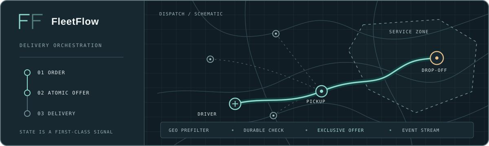
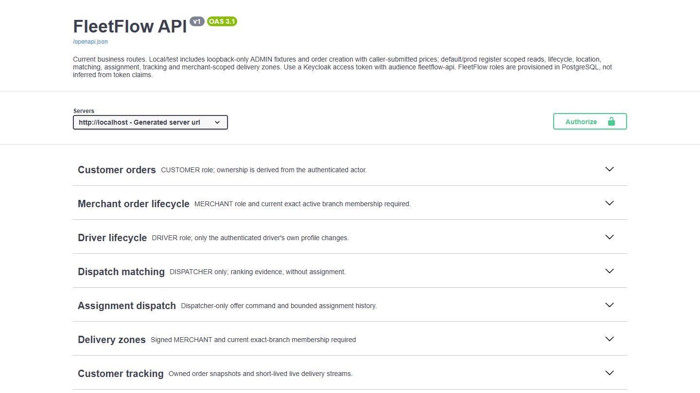
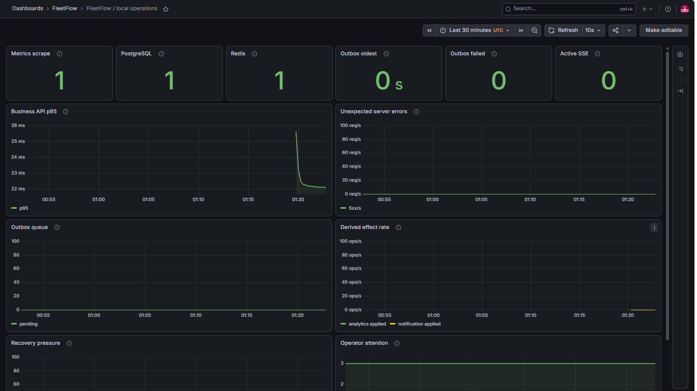
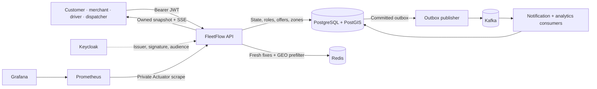
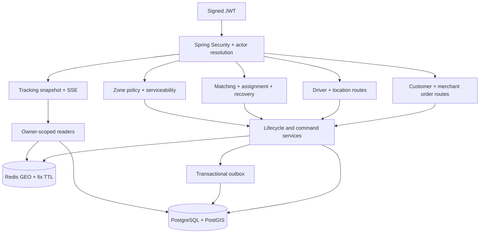
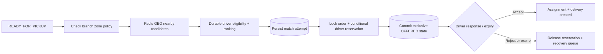
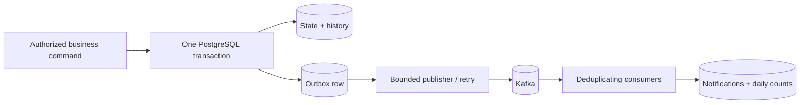
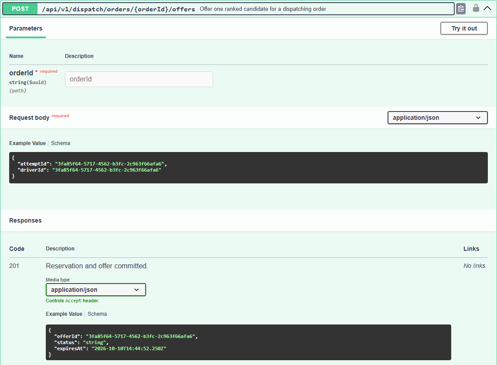
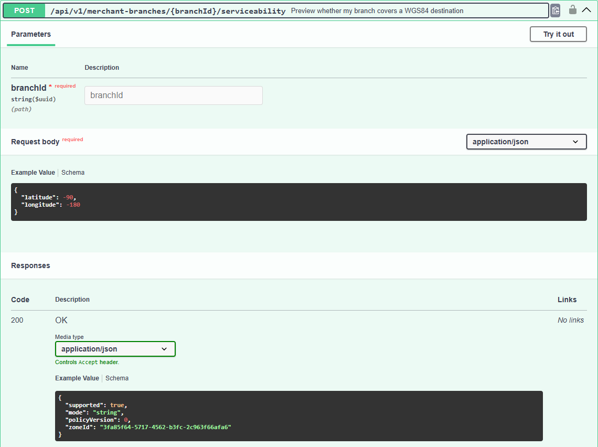
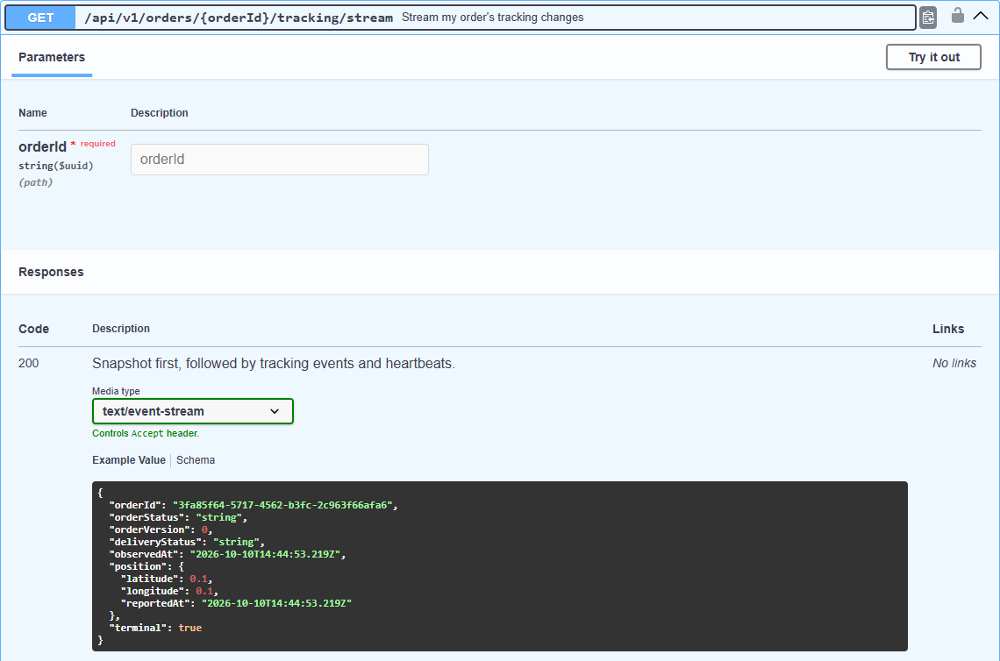

# FleetFlow

**A Java 21 delivery orchestration backend that turns changing locations, competing dispatch decisions, and order handoffs into guarded, observable state.**

`Spring Boot 4.1.1` · `PostgreSQL / PostGIS` · `Redis GEO` · `Kafka` · `Keycloak / OIDC` · `Docker Compose` · `Prometheus / Grafana`

> **Project scope:** A backend engineering and portfolio project with a loopback local demo. Trusted commercial pricing, payments, and public production order intake are outside its implemented scope. The [Phase 11 record](docs/phases/phase11.md) is `CLOSED_PARTIAL` with unverified acceptance gates.

## At a glance

| | |
| --- | --- |
| **Delivery core** | Customer and branch-scoped merchant orders; guarded driver, order, offer, and delivery transitions. |
| **Dispatch** | Redis GEO candidate prefilter, durable eligibility checks, ranked match attempts, and exclusive time-bound offers. |
| **Geospatial** | Versioned PostGIS branch zones; boundary-inclusive `ST_Covers` checks when zone policy is enforced. |
| **Events + tracking** | Transactional outbox → Kafka → deduplicated projections; owned snapshots and short-lived SSE streams. |
| **Trust boundary** | Signed Keycloak JWTs identify callers; PostgreSQL resolves active roles, ownership, and exact-branch membership. |
| **Evidence** | Testcontainers integration suite, generated OpenAPI coverage, GitHub Actions, and dated local operations exercises. |

## See FleetFlow in action

The local profile generates an interactive API reference; the optional monitoring overlay provisions a Grafana operations view.

<table>
  <tr>
    <td width="50%" valign="top">
      <a href="docs/assets/readme/swagger-overview.png"></a><br>
      <strong>API reference</strong> · Generated local-profile routes and access boundaries.
    </td>
    <td width="50%" valign="top">
      <a href="docs/assets/readme/grafana-local-operations.png"></a><br>
      <strong>Operations view</strong> · Grafana during the 2026-10-09 local exercise.
    </td>
  </tr>
</table>

The [observability record](docs/operations/PHASE11_OBSERVABILITY_EVIDENCE.md) explains the dated dashboard capture; it is not a live health report. Click either image to inspect it at full size.

## Engineering highlights

| Concern | Implemented behavior |
| --- | --- |
| **Guarded lifecycles** | Customer, merchant, and driver commands enforce legal transitions and write durable history; conflicting or repeated actions fail explicitly. |
| **Atomic dispatch** | The offer transaction locks its order, reserves an available driver conditionally, and uses partial unique indexes to exclude competing active offers. Acceptance rechecks ownership, state, and expiry. |
| **Geographic policy** | Redis narrows nearby drivers; PostgreSQL/PostGIS decides branch serviceability from versioned zones. A Redis location cannot authorize an order or offer. |
| **Owned live tracking** | A customer can read a current snapshot or bounded SSE stream for an owned order. PostgreSQL controls visibility; a fresh Redis fix is optional and never treated as durable assignment truth. |
| **Async projections** | Business state and outbox intent commit together. Kafka publication and deduplicated notification/analytics projections follow asynchronously. |
| **Operational visibility** | Health, metrics, correlation IDs, route limits, private scraping, Grafana panels, alerts, and backup/restore tooling support the local exercises. |

**Explore:** [Architecture](#architecture) · [API surface](#api-surface) · [Swagger gallery](#swagger-gallery) · [Engineering choices](#engineering-choices) · [Technology and verification](#technology-and-verification) · [Run locally](#run-locally) · [Status](#deployment-and-verified-status) · [Repository map](#repository-map)

## Architecture

### System architecture

FleetFlow is one Spring Boot backend. PostgreSQL holds the durable order, offer, assignment, zone, actor, and recovery records. Redis stores expiring location and proximity data. Kafka carries events after the business transaction commits.



### Inside the backend

These are responsibilities within the same process, not separately deployed services. Request security resolves the signed subject to an active FleetFlow actor before object-level checks; application services coordinate durable writes and outbox records.



### From ready order to exclusive offer

Matching records ranked evidence; offer creation is a separate guarded command. Recovery handles rejected or expired offers without allowing two active claims for one order or driver.



The main successful path is `CREATED → CONFIRMED → PREPARING → READY_FOR_PICKUP → DISPATCHING → DRIVER_ASSIGNED → PICKED_UP → IN_TRANSIT → COMPLETED`. Cancellation and failure edges have separate guards in the [state machines](docs/architecture/STATE_MACHINES.md).

### From committed command to derived view



The consistency boundary is PostgreSQL. A committed command may be visible before its Kafka-backed projection; Redis loss or a delayed consumer does not change the committed business decision. See the [architecture plan](docs/architecture/ARCHITECTURE_PLAN.md) and [event record](docs/phases/PHASE_8.md) for the detailed boundaries.

## API surface

Business routes are under `/api/v1`. The local-profile OpenAPI test verifies **57 registered operations** against Spring's route registry; the table shows the shape of the API without listing every endpoint.

| Capability | Representative routes | Access |
| --- | --- | --- |
| Customer orders | `GET /orders`, `GET /orders/{id}`, `POST /orders/{orderId}/cancel` | Signed customer; own orders only |
| Merchant preparation | `POST /merchant-branches/{branchId}/orders/{orderId}/ready-for-pickup` | Merchant with current membership of that branch |
| Driver self actions | `POST /drivers/me/available`, `POST /drivers/me/location`, `POST /drivers/me/offers/{offerId}/accept` | Signed driver; own state and offers |
| Dispatch + recovery | `POST /dispatch/orders/{orderId}/match`, `POST /dispatch/orders/{orderId}/offers`, `POST /dispatch/orders/{orderId}/retry` | Dispatcher |
| Serviceability | `GET /merchant-branches/{branchId}/zones`, `POST /merchant-branches/{branchId}/serviceability` | Merchant with exact-branch membership |
| Tracking | `GET /orders/{orderId}/tracking`, `GET /orders/{orderId}/tracking/stream` | Customer owner; SSE is short-lived |
| Local order fixture | `POST /orders` | Loopback `local` / `test` only; signed customer |

Table paths omit the common `/api/v1` prefix. Local order creation accepts caller-supplied prices and is a learning fixture, not trusted production intake. Local fixture administration is also profile-limited. The default and `prod` profiles disable Swagger and OpenAPI endpoints.

## Swagger gallery

Run the `local` profile and open [Swagger UI](http://127.0.0.1:8080/swagger-ui/index.html) or [OpenAPI JSON](http://127.0.0.1:8080/v3/api-docs). Both URLs require a running local instance. The [OpenAPI coverage test](src/test/java/com/fleetflow/OpenApiDocsTests.java) checks the generated document against registered routes.

The captures below render that test-generated local OpenAPI document in the bundled Swagger UI. Core groups were ordered first in the overview capture. The examples are generated schemas, not executed commands or live business data; each operation image is cropped after its success response.

<details>
<summary><strong>Dispatch, geographic policy, and live tracking</strong> · 3 API captures</summary>

**Exclusive dispatch offer** · A ranked attempt and driver become a time-bound offer.



**Branch serviceability** · The request supplies a WGS84 destination for the current branch policy.



**Owned tracking stream** · The SSE response starts with a current snapshot.



</details>

## Engineering choices

| Choice | Why |
| --- | --- |
| PostgreSQL as consistency boundary | Order transitions, roles, reservations, and recovery remain durable when Redis or Kafka is unavailable. |
| Redis GEO as a bounded prefilter | Efficient nearby-driver lookup without making expiring coordinates the source of eligibility or authority. |
| PostGIS `ST_Covers` for zones | Versioned service polygons are queryable, enforceable, and include points exactly on a boundary. |
| Row locks and partial unique indexes | Competing dispatchers cannot keep simultaneous active offers for the same order or driver. |
| Transactional outbox | State and publishable event intent commit atomically; delivery to Kafka may retry later. |
| Database actor resolution | A valid JWT identifies a subject; current roles, customer ownership, and merchant branch scope come from FleetFlow data. |
| Owned SSE snapshots | A lightweight live view can resume from current durable state without claiming durable event replay. |

## Technology and verification

| Layer | Stack |
| --- | --- |
| Backend | Java 21, Spring Boot 4.1.1, Spring Security, Spring Data JPA, Maven |
| Durable data | PostgreSQL 17, PostGIS, Flyway |
| Ephemeral location | Redis GEO and expiring driver fixes |
| Events | Apache Kafka, transactional outbox, deduplicating consumers |
| Identity | Keycloak OIDC/JWT, OAuth2 Resource Server, application actor/object scope |
| Operations | Docker Compose, Actuator, Micrometer, Prometheus, Grafana, alert configuration, PowerShell recovery scripts |
| Verification | JUnit, Spring integration tests, Testcontainers, GitHub Actions |

On 2026-10-10, the Phase 11 backend branch recorded a full `clean verify` pass of **124 tests, 0 failures, 0 errors, 0 skips** after its Keycloak image update. The suite covers PostgreSQL/PostGIS, Redis, Kafka, Keycloak, and API behavior through Testcontainers-backed integration tests. [GitHub Actions](.github/workflows/verify.yml) runs a tracked-credential preflight and Maven verification; a local pass is not a claim about the current remote CI result. Scenario records include [atomic assignment](docs/phases/PHASE_6.md), [tracking](docs/phases/Phase9.md), and [zones](docs/phases/Phase10.md).

## Run locally

Install Java 21, Docker Desktop with Compose, Git, and PowerShell. Copy `.env.example` to ignored `.env`, replace its password and Keycloak admin placeholders with private local values, and keep the configured loopback ports aligned.

```powershell
git clone https://github.com/Omar-Mega-Byte/fleetflow.git
cd fleetflow
Copy-Item .env.example .env
# Edit .env before starting the stack.
docker compose --env-file .env -p fleetflow up -d --build --pull never
docker compose --env-file .env -p fleetflow ps
```

The Compose application uses `prod`; check [readiness](http://127.0.0.1:8080/actuator/health/readiness) on a running stack. `--pull never` uses cached pinned images; fetch an absent image intentionally before retrying. For local Swagger and fixture routes, stop only the Compose app and run the loopback profile in a second terminal:

```powershell
docker compose --env-file .env -p fleetflow stop app
.\scripts\Run-Local.ps1
```

Open [Swagger UI](http://127.0.0.1:8080/swagger-ui/index.html). Identity comes from a Keycloak access token; FleetFlow roles and branch membership must also be provisioned. The [local demo](docs/operations/PHASE11_DEMO.md) and [security design](docs/architecture/ADR-0003-oidc-and-object-scope.md) cover actor setup. After stopping the host-run app, `docker compose --env-file .env -p fleetflow start app` restores the Compose app.

Run tests with `.\mvnw.cmd clean verify`. The [monitoring runbook](docs/operations/MONITORING.md) adds the `compose.monitoring.yaml` overlay and private Grafana credential; Grafana then binds to [loopback port 3000](http://127.0.0.1:3000/). Prometheus scrapes over the private Compose network and has no host-published UI port. Stop the stack with `docker compose --env-file .env -p fleetflow down`; omit `--volumes` to retain local database data.

## Deployment and verified status

The Compose topology is a loopback learning and operations exercise: Keycloak uses development mode, service ports are local, and the optional monitoring scrape stays private. Dated records document signed local workflows, dashboard and load exercises, and restore from an independently retrieved remote archive. These observations do not prove multi-host recovery or public deployment readiness.

**Phase 11 is `CLOSED_PARTIAL` on this branch.** A regular 02:00 Cairo backup succeeded on 2026-10-10, but the [acceptance record](docs/phases/phase11.md) leaves 24-hour RPO evidence, replacement-host recovery, specified resilience and object-scope drills, service-image advisory disposition, and final stacked-PR integration unverified. The operator cancelled the remaining Phase 11 acceptance work; no production-readiness claim follows. The [backup/restore runbook](docs/operations/BACKUP_RESTORE.md) and [monitoring runbook](docs/operations/MONITORING.md) separate measured exercises from those limits.

## Repository map

```text
src/main/java/com/fleetflow/   Orders, dispatch, zones, tracking, security, events
src/main/resources/            Flyway migrations, OIDC realm, application profiles
src/test/java/com/fleetflow/   Unit and Testcontainers integration tests
docs/                         Architecture, roadmap, phase evidence, operations
docs/assets/readme/           Hero artwork and dated local dashboard capture
ops/monitoring/               Prometheus, Grafana, and alert configuration
scripts/                      Local run, backup, restore, and verification tools
compose*.yaml                 Local stack and optional monitoring overlays
```

**CV summary:** Built a Java 21/Spring Boot delivery orchestration backend with guarded order and driver lifecycles, concurrency-safe dispatch offers, Redis GEO candidate ranking, PostGIS serviceability zones, outbox-backed Kafka projections, Keycloak object-level authorization, owned live tracking, and Testcontainers-backed verification.
